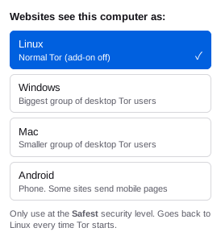
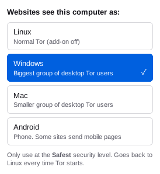

# OS Header Switch

**An unofficial add-on for Tor Browser on Linux.** It brings back the User-Agent header disguise that Tor Browser removed in version 14.5, and lets you choose whether websites see **Windows**, **Mac** or **Android** instead of Linux.

> Not made, endorsed or sponsored by the Tor Project. See [Disclaimer](#disclaimer).

<p align="center">
  
  &nbsp;&nbsp;
  
</p>

## Contents

- [What it does](#what-it-does)
- [Why it exists](#why-it-exists)
- [Every choice is Tor Browser's own label](#every-choice-is-tor-browsers-own-label)
- [Only use it at the Safest security level](#only-use-it-at-the-safest-security-level)
- [Which to pick](#which-to-pick)
- [Install](#install)
- [Using it](#using-it)
- [Check it's working](#check-its-working)
- [How it works](#how-it-works)
- [Privacy](#privacy)
- [Limits](#limits)
- [Update or uninstall](#update-or-uninstall)
- [Building it yourself](#building-it-yourself)
- [Version history](#version-history)
- [Disclaimer](#disclaimer)
- [Credits and license](#credits-and-license)

## What it does

Every time your browser asks a website for something, it sends a line called the **User-Agent** that says what kind of computer you're on. Tor Browser on Linux sends this:

```
Mozilla/5.0 (X11; Linux x86_64; rv:140.0) Gecko/20100101 Firefox/140.0
```

This add-on lets you swap it for the line Tor Browser sends on a different system:

| Choice | What websites receive |
|---|---|
| **Linux** (add-on off) | `Mozilla/5.0 (X11; Linux x86_64; rv:140.0) Gecko/20100101 Firefox/140.0` |
| **Windows** | `Mozilla/5.0 (Windows NT 10.0; Win64; x64; rv:140.0) Gecko/20100101 Firefox/140.0` |
| **Mac** | `Mozilla/5.0 (Macintosh; Intel Mac OS X 10.15; rv:140.0) Gecko/20100101 Firefox/140.0` |
| **Android** | `Mozilla/5.0 (Android 10; Mobile; rv:140.0) Gecko/140.0 Firefox/140.0` |

`140.0` is your Tor Browser's version number. The add-on copies it from Tor Browser's own header, so it stays correct after updates.

## Why it exists

Until April 2025, Tor Browser on Linux and Mac told websites it was Windows in this header, so desktop Tor users looked alike. Tor Browser 14.5 removed that disguise, and the header now shows your real type of system. The Tor Project's reasons were that the disguise didn't hide much once page scripts were on, and that it broke some websites ([Tor Project statement](https://x.com/torproject/status/1915112914333450397), [14.0a4 announcement](https://blog.torproject.org/new-alpha-release-tor-browser-140a4/)).

Linux users are a much smaller group than Windows users, so the "Linux" label makes you easier to pick out. This add-on brings the old disguise back as something you switch on and off yourself.

## Every choice is Tor Browser's own label

The add-on doesn't make anything up. The four labels, and the way the header is put together, are copied from Tor Browser's source code:

- the labels: `toolkit/components/resistfingerprinting/nsRFPService.h`
- the layout: `GetSpoofedUserAgent()` in `toolkit/components/resistfingerprinting/nsRFPService.cpp`

Both were checked against Tor Browser **14.0** (branch `tor-browser-128.9.0esr-14.0-1`, the last version with the header disguise) and **15.0** (branch `tor-browser-140.17.0esr-15.0-1`). Whatever you pick, your header matches, character for character, what real Tor Browser users on that system send.

That's also why there's no option for an unusual system. Tor Browser reports every other system (BSD and the rest) as Linux, so no Tor user ever sends anything else, and an odd label would make you unique.

## Only use it at the Safest security level

Like Tor Browser 14.0, the add-on changes only the header. Scripts running on a page can still tell you're on Linux.

| Security level | What websites see | Result |
|---|---|---|
| **Safest** (scripts off) | Only the header | You blend in with Tor users on the system you picked ✅ |
| Standard or Safer (scripts on) | The header says, say, Windows; the scripts say Linux | No normal Tor Browser does that, so you stand out ❌ |

To set it, open Tor Browser's **Settings → Privacy & Security**, find **Security Level** and choose **Safest**. If the shield icon is in your toolbar, you can use that instead.

## Which to pick

- **Windows** is recommended. It's the biggest group of desktop Tor users.
- **Mac** works too, but it's a smaller group.
- **Android** is the weakest disguise. Some sites will send phone versions of pages, and a desktop-sized window claiming to be a phone is easier to spot.

## Install

You need **Tor Browser 14.5 or later on Linux**. On Windows or Mac versions of Tor Browser, the add-on does nothing.

1. **Download** `os-header-switch-2.1.xpi` from the [Releases page](https://github.com/robbiesayers/TOR-OS-header-switch/releases).
2. **Allow home-made add-ons.** In Tor Browser, type `about:config` in the address bar and press Enter. Click **Accept the Risk and Continue**, search for `xpinstall.signatures.required`, and double-click it so it says `false`.
   - This is needed because the add-on isn't signed by Mozilla.
   - Leave it on `false` afterwards. Switching it back disables the add-on straight away.
3. **Install it.** Type `about:addons` in the address bar, click the ⚙ gear, choose **Install Add-on From File…**, and pick the `.xpi` file you downloaded.
4. Tor Browser warns that this is an "unverified extension". That's expected for an add-on that isn't signed by Mozilla.
5. **Tick "Allow extension to run in private windows"**, then click **Add**. Tor Browser is always in private mode, so without this tick the button never appears.
6. A grey square button appears in the toolbar. You're done.

If you missed the tick in step 5, go to `about:addons`, open **OS Header Switch**, and set **Run in Private Windows** to **Allow**.

## Using it

- Click the button to open the menu, then pick a system. The badge on the button shows **WIN**, **MAC** or **AND**.
- A grey button with no badge means **Linux (off)**. While it's off, the add-on doesn't touch your traffic at all.
- It goes back to Linux **every time Tor Browser starts**, so it's never left on by accident.
- Before switching to a lower security level, set the add-on back to Linux.

## Check it's working

With **Safest** on and a system picked, visit <https://httpbin.org/headers>. The `User-Agent` line should match the table in [What it does](#what-it-does).

## How it works

- It's a small WebExtension (Manifest V2). It uses `webRequest.onBeforeSendHeaders` to change only the `User-Agent` request header, on every request: pages, images, background requests and WebSocket connections.
- It only changes the exact header Tor Browser on Linux sends: `Mozilla/5.0 (X11; Linux x86_64; rv:N.0) Gecko/20100101 Firefox/N.0`. If a future Tor Browser changes that format, the add-on leaves the header alone rather than send something odd.
- For Android it also changes `Gecko/20100101` to `Gecko/N.0`, because that's what Tor Browser for Android sends.
- When set to Linux, the header-changing code is switched off completely.
- `navigator.userAgent` (what page scripts see) isn't changed, the same as in Tor Browser 14.0.
- Your choice is kept in memory only and never saved.

| Permission it asks for | Why |
|---|---|
| Access your data for all websites (`<all_urls>`, `webRequest`, `webRequestBlocking`) | Needed to change the header on requests to any site. The add-on doesn't read or keep anything else. |

## Privacy

- It collects no data, sends nothing anywhere, and makes no network requests of its own.
- It adds nothing to the pages you visit, so websites can't detect it directly. They only see the header itself.
- No settings or history are saved.

## Limits

- It only helps at the **Safest** security level.
- It only changes the header. Your IP address, your Tor connection and everything else stay with Tor Browser as normal.
- Some sites' bot detectors may show more "prove you're human" checks. That was one reason the Tor Project removed the feature.
- The benefit is real but modest: with scripts off there's already less to hide. Think of it as an extra layer, not a shield.
- It isn't signed by Mozilla, so it doesn't update itself. After a big Tor Browser update, check it again with httpbin.org/headers.

## Update or uninstall

- **Update:** install the newer `.xpi` the same way. It replaces the old version.
- **Uninstall:** go to `about:addons`, open **OS Header Switch**, click **⋯**, then **Remove**. You can then set `xpinstall.signatures.required` back to `true`.

## Building it yourself

The `.xpi` is just a zip of the add-on's files:

| File | What it does |
|---|---|
| `manifest.json` | Name, version and permissions |
| `background.js` | Changes the header |
| `popup.html`, `popup.js` | The menu |
| `icon-off.svg`, `icon-on.svg` | Toolbar icons |

```sh
zip -X os-header-switch.xpi manifest.json background.js popup.html popup.js icon-off.svg icon-on.svg
```

## Version history

- **2.1** (October 2026): first public release.

## Disclaimer

This product is not endorsed or sponsored by, or affiliated with, the Tor Project. "Tor" is a trademark of The Tor Project; all rights reserved. Official Tor website: <https://torproject.org>.

Use it at your own risk. See [LICENSE](LICENSE).

## Credits and license

Made by [@robbiesayers](https://github.com/robbiesayers).

The header labels come from Tor Browser's source code, which is published under the Mozilla Public License 2.0.

This add-on is released under the [MIT License](LICENSE).
